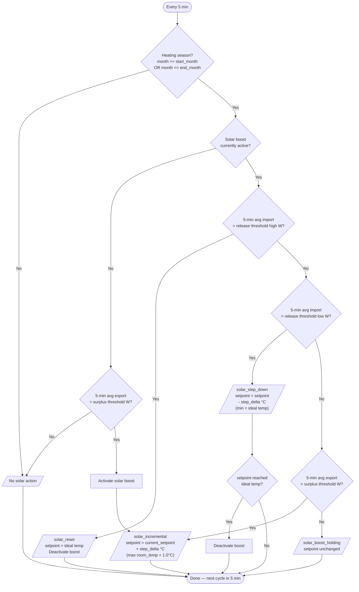

# Smart Heatpump Controller for Home Assistant

An intelligent thermostat controller that uses solar surplus to store free energy as heat in your floor. It adjusts your thermostat setpoint automatically — no direct heat pump API required. All logic runs locally with no cloud dependency.

---

## What it does

During the heating season, the controller watches your solar export in real time. When you're exporting more than you need, it incrementally raises the thermostat setpoint to store that free solar energy as heat in your floor mass. When the sun disappears and you start importing, it steps the setpoint back down — or resets immediately on high import.

Your temperature stays within a comfort band you define, without manual intervention.

---

## How it works

The controller runs every 5 minutes (configurable) and follows this decision flow:



### Key concepts

- **Heating season** — the flow only runs during configurable months (default September–April). Outside these months, no thermostat changes are made.
- **Incremental boost** — when solar boost first activates, the setpoint is set to `current_room_temperature + step_delta`. On each subsequent cycle with continued surplus, the setpoint steps up further from the *current setpoint* (not room temp). This means the setpoint climbs in steps: e.g. 21.5 → 22.0 → 22.5. The maximum boost is capped at **1.0°C above current room temperature** (two steps with the default 0.5°C delta), preventing overshooting.
- **5-minute rolling average** — both activation (export) and release (import) thresholds use a 5-minute rolling average to avoid reacting to brief spikes (e.g. a kettle or oven).
- **Two-tier release** — moderate import triggers a gradual step-down; high import triggers an immediate reset to ideal temperature.

### Real-world example

> **10:00** — Solar panels exporting 600W on average over the last 5 minutes. Export exceeds the 300W threshold → `solar_incremental` activates. Room is 21.0°C, so setpoint goes to 21.5°C.
>
> **10:05** — Still exporting surplus. Setpoint steps up from 21.5 → 22.0°C. Room is 21.1°C, cap is 21.1 + 1.0 = 22.1°C — still within cap.
>
> **10:10** — Still exporting. Setpoint would go to 22.5°C, but room is 21.2°C, cap is 22.2°C → clamped to **22.2°C**. Maximum boost reached.
>
> **10:30** — Room is 22.0°C. Cloud cover reduces production. 5-min average import rises to 400W (above 300W low threshold) → `solar_step_down`. Setpoint → 22.2 - 0.5 = 21.7°C.
>
> **10:35** — Heavy cloud. 5-min average import rises to 800W (above 700W high threshold) → `solar_reset`. Setpoint → 21.0°C (ideal). Boost deactivated.
>
> **10:40** — Sun returns, export is 700W → `solar_incremental` re-activates.

---

## Thermal learning system

The controller includes a thermal learning model that continuously learns your home's insulation characteristics. It observes indoor/outdoor temperatures during periods when heating is off (primarily nighttime cool-downs), calculates a heat loss coefficient, and can predict how many hours until your indoor temperature drops below the ideal.

This learning runs **independently** — it does not control the thermostat. The data is exposed via the **Thermal learning** sensor for your information and can be used in future automations.

### Solar gain filtering

The thermal model excludes observations where solar gain is likely (solar export detected, Forecast.Solar predicting production, or sun above 5° elevation). This ensures the model learns from clean nighttime cool-downs and produces a conservative heat loss estimate.

---

## Installation

### Step 1 — Add the repository in HACS

1. Open **HACS** in Home Assistant.
2. Click the **three dots** menu (top right) → **Custom repositories**.
3. Paste `https://github.com/antongitnow/ha-smart-heatpump` and select type **Integration**.
4. Click **Add**, then find **Smart Heatpump Controller** and click **Download**.
5. **Restart Home Assistant.**

### Step 2 — Add the integration

1. Go to **Settings → Devices & services**.
2. Click **+ Add integration** (bottom right).
3. Search for **Smart Heatpump Controller**.
4. Fill in the form:
   - **Power sensor** — your smart meter / P1 sensor (W). Must return negative values when exporting.
   - **Weather entity** — defaults to `weather.home` (Met.no).
5. Click **Submit**.
6. Go to **Configure** to add your thermostat, indoor temperature sensor, and notification targets.

### Dry run mode

Leave the thermostat field empty during setup. The controller runs normally — reads sensors, evaluates rules, logs decisions, and sends notifications — but does not touch any thermostat. The **Active rule** sensor shows a `mode: dry_run` attribute and the computed setpoint it *would* have set.

### Step 3 — Add the solar boost tuner card (optional)

The integration ships its own dashboard card; it loads automatically, no HACS frontend install needed.

1. Open your dashboard → **Edit** (pencil icon) → **+ Add Card**.
2. Search for **Smart Heatpump solar boost tuner**, or choose **Manual** and paste [`lovelace/dashboard_card.yaml`](lovelace/dashboard_card.yaml).
3. Click **Save**. If the card isn't found right after updating, reload the browser page.

See [Solar boost tuner card](#solar-boost-tuner-card) for what it shows.

---

## Configuration

All parameters appear as slider entities under the **Smart Heatpump Controller** device.

| Parameter | Default | Range | Unit | Description |
|---|---|---|---|---|
| Ideal temperature | 21.0 | 16–26 | °C | Default comfort setpoint and safety floor |
| Minimum temperature | 20.5 | 14–24 | °C | Hard floor — setpoint never goes below this |
| Evaluation interval | 5 | 1–60 | min | How often the controller re-evaluates |
| Heating season start month | 9 | 1–12 | month | First month of heating season (e.g. 9 = September) |
| Heating season end month | 4 | 1–12 | month | Last month of heating season (e.g. 4 = April) |
| Solar export surplus threshold | 300 | 0–5000 | W | 5-min avg export above which solar boost activates |
| Solar release threshold high | 700 | 0–5000 | W | 5-min avg import above which boost resets immediately |
| Solar release import threshold low | 300 | 0–5000 | W | 5-min avg import above which boost steps down |
| Solar step delta | 0.5 | 0.1–3.0 | °C | How much to boost/step-down per cycle |
| Electricity price | 0.30 | 0–1 | €/kWh | What you pay per kWh from the grid (used for savings) |
| Feed-in compensation | 0.00 | 0–1 | €/kWh | What an exported kWh earns you (used for savings) |

With a [home battery](#home-battery-optional) four more sliders appear: *Battery discharge limit*, *Battery reaction time*, *Cooldown after battery reset* and *Heat pump boost draw*.

---

## Notifications

The controller sends a push notification every time it changes the thermostat setpoint.

1. Go to **Settings → Devices & services → Smart Heatpump Controller → Configure**.
2. In the **Notification targets** field, enter your notify service names (comma-separated, without the `notify.` prefix):
   ```
   mobile_app_my_phone, telegram
   ```
3. Click **Submit**.

Use the **Notifications** switch on the device or dashboard to mute/unmute without reconfiguring.

**Example notification:**

> **Smart Heatpump**
>
> ☀️ Solar surplus — boosting setpoint by step delta above current room temperature
>
> Rule: solar_incremental
> Room: 21.2°C
> Outdoor: 6.2°C
> Setpoint: 21.0°C → 21.7°C
>
> Current power: Export 680W
> 5-min avg: Import 0W
>
> Thresholds:
> &nbsp;&nbsp;Export surplus activate: >300W avg export
> &nbsp;&nbsp;Release high: >700W avg import
> &nbsp;&nbsp;Import release low: >300W avg import
> &nbsp;&nbsp;Step delta: 0.5°C

---

## Forecast.Solar (optional)

Forecast.Solar predicts solar production based on your panel configuration. When configured, the controller uses this data to improve the **thermal learning system** — it helps detect solar gain periods more accurately and excludes them from the heat loss model.

1. Install **Forecast.Solar** via HACS or the built-in integration.
2. Go to **Settings → Devices & services → Smart Heatpump Controller → Configure**.
3. Select your Forecast.Solar entity (typically `sensor.energy_production_next_hour`).
4. Click **Submit**.

---

## Home battery (optional)

A home battery that aims for zero on the meter (NOM) changes what the P1 meter shows. It charges from solar surplus first, so the controller sees export only once the battery is full or the surplus is above its charge power. And it discharges to cover import, so during a boost it would quietly feed the heat pump while the meter stays at 0 W. Add the battery's power sensor and the controller handles both: **a boost never runs on battery power**. Outside a boost nothing changes — the heat pump can run on the battery as usual.

1. Go to **Settings → Devices & services → Smart Heatpump Controller → Configure**.
2. Select the **Home battery power sensor** (W or kW): the power flowing into or out of the battery.
3. Set **Battery sensor is positive when** to *Discharging* or *Charging*, to match your sensor.
4. Click **Submit**.

For a **Zendure SolarFlow**, use `Battery Power` (`sensor.solarflow_..._bat_in_out`): positive while discharging. It measures the battery side, so it differs a few percent from what reaches the house, which is close enough here.

The controller only reads the battery and never controls it, so it works next to whatever manages the battery (Zendure's own HEMS, the Zendure Manager, another HEMS). Make sure only one of those steers the battery.

### Rules

1. **Grid power without the battery.** The controller decides on what the meter would show without the battery: *P1 + battery discharge − battery charge*. Battery discharge always counts as import. Battery charging counts as export only with **Solar to heat pump before battery** on.
2. **Start a boost** when the 5-minute average export is above both the surplus threshold and the **Heat pump boost draw** — so the surplus covers the heat pump and the battery doesn't have to.
3. **Battery reset** (`solar_reset_battery`). When the battery discharges more than the **Battery discharge limit** (default 50 W) for the **Battery reaction time** (default 2 min) during a boost, the setpoint goes straight back to ideal and the boost ends. This overrides the minimum boost duration, and the controller acts on the battery sensor's own readings instead of waiting for its next evaluation.
4. **Cooldown** (`solar_battery_cooldown`). After a battery reset, no new boost starts for the **Cooldown after battery reset** (default 30 min), so passing clouds don't make boosts start and stop over and over.
5. **Release thresholds** still apply, to the import without the battery.
6. **Battery sensor unavailable** (`battery_unavailable`): no new boost starts; a running boost continues on the P1 rules.

**Heat pump boost draw** at 0 (the default) means *learn it*: the controller learns the heat pump's draw while it runs during a boost, from the heat pump power sensor (a moving average over about 2 hours), and assumes 750 W until it has seen one. Set a value to use that instead. The **Active rule** sensor shows the value in use as `boost_draw_w`.

**Solar to heat pump before battery** (switch, default off):
- **Off — battery first.** Only real export starts a boost: the battery fills first, and the boost gets what's left over. Once a boost runs, a battery aiming for zero on the meter cuts its charging to cover the heat pump, so in practice the heat pump then gets the surplus first.
- **On — heat pump first.** Battery charging counts as surplus, so a boost can start on solar the battery would otherwise store.

### Good to know

- **The controller can't tell what the battery powers.** A kettle or oven during a boost makes the battery discharge too, which ends the boost and starts the cooldown.
- **Up to a minute or two on the battery.** Between the start of a discharge and the reset, the battery can supply up to its full power — for an 800 W battery and the default reaction time, about 25 Wh.
- **Fewer boosts on small surpluses.** A surplus below the heat pump's boost draw goes to the battery instead.
- **Savings are slightly high.** They're valued against the feed-in price, but without the boost some of that solar would have gone into the battery rather than the grid.
- **Cloud-connected batteries report late.** The reaction time absorbs a short delay; a local connection is more reliable.

## Daily figures and savings

The controller measures what its boosts actually did, per day. Boost figures need only the P1 sensor; energy and savings also need your heat pump's **power sensor** (W or kW), selected under **Configure → Heat pump power sensor**.

Every reading of the heat pump and P1 sensors is integrated over time. While a solar boost is active (and the controller is not in dry run), the heat pump's draw is split in two: other loads in the house get the solar first, so the heat pump's **grid share** is the smaller of its draw and the grid import, and the rest is **solar**. Outside a boost nothing counts as solar. With a home battery, battery discharge counts as import: battery power is not solar, and *grid import while boosting* includes it.

With a **heat output sensor** (Configure → Heat pump heat output sensor — for Quatt, `CIC Total power`), the heat delivered while boosting is split the same way: **heat from solar** is the heat output times the solar share of the heat pump's draw. At a COP of 5, 1 kWh of solar electricity becomes about 5 kWh of heat in the floor.

**Savings** are the solar kWh valued at *Electricity price − Feed-in compensation*, at the prices set when the energy was used. Set the feed-in compensation to what an exported kWh really earns you: with full net metering (salderen) an exported kWh is worth as much as an imported one, so moving it to the heat pump saves little; once net metering ends, it saves almost the whole electricity price.

| Sensor | Needs heat pump meter | Description |
|---|---|---|
| `Savings today` | yes | € saved today. Attributes: yesterday, last 7 days, this month, solar kWh today, prices used. |
| `Savings total` | yes | Lifetime € saved. |
| `Heat pump solar energy` | yes | Lifetime kWh the heat pump ran on solar during boosts (`total_increasing`). |
| `Heat pump solar energy today` | yes | kWh today. Attributes: total heat pump kWh today, `solar_share_today_pct`, yesterday, last 7 days, this month, and the last 14 days as a per-day map. |
| `Heat from solar today` | + heat output sensor | kWh of heat produced from solar during boosts. Attributes: yesterday, last 7 days, this month. |
| `Heat from solar` | + heat output sensor | Lifetime kWh of heat from solar (`total_increasing`). |
| `Heat pump grid import while boosting today` | yes | kWh the heat pump drew from the grid during boosts — the import between a change in sunshine and the controller's reaction. |
| `Boost time today` | no | Minutes a boost was active. |
| `Export not used today` | no | kWh exported while no boost was active. |
| `Boosts today` / `Boost resets today` | no | Boosts started, and boosts reset on high import. |
| `Battery resets today` | battery sensor | Boosts reset because the battery discharged. |

The daily sensors have a midnight `last_reset` and `yesterday` / `last_7_days` / `this_month` attributes. Home Assistant keeps their long-term statistics, so a `statistics-graph` card shows them per day, week or month:

```yaml
type: statistics-graph
title: Solar boost savings per day
chart_type: bar
period: day
days_to_show: 30
stat_types: [change]
entities:
  - sensor.smart_heatpump_controller_savings_today
```

---

## Solar boost tuner card

At the top, **Today so far** shows the measured figures from the sensors above: heat pump kWh on solar with the € saved, heat from solar with the COP (when a heat output sensor is set), heat pump grid import while boosting, boost time, export not used, and boosts / resets, each with yesterday's value.

Below it, a day of grid power with your three solar thresholds drawn on it. Drag a line to try a different value; the card replays that day's decisions with the same logic the controller uses, so you see the effect before you change anything.

- **Bars** — grid import (up) and export (down), as 5-minute averages, in the Energy dashboard colours.
- **Dashed lines** — *Surplus* (export needed to start a boost), *Release low* (import that steps the setpoint down) and *Release high* (import that resets the boost). Drag a line or its label; with keyboard focus on a label, arrow keys move it by 50 W.
- **Shaded columns** — when a boost would have been active.
- **Bottom strip** — the replayed setpoint and the measured room temperature.
- **Tiles** — boost time, export used while boosting, grid import while boosting, export left unused, and boost starts / resets, each compared with your saved thresholds. With a **heat pump power sensor** configured, grid import while boosting counts only what the heat pump drew from the grid (other appliances get the solar first), so a kettle or dishwasher running during a boost isn't blamed on it. Without one it is the whole house's import. Many starts and resets mean the thresholds are too close together and the boost flaps on and off.
- **What do the three lines do?** — an expandable explanation of each threshold, filled in with your current values. Hovering a line's label shows a one-line summary.
- **Save thresholds** writes the new values to the number entities. **Back to saved** discards the edit.

Use the arrows to replay one of the last 10 days (the recorder's default history). Hover a bar to see the rule the controller would have applied at that moment.

The heat pump's recorded run times come from what the controller really did that day, so when a replayed boost falls at another time the heat pump figures are an estimate. The replay uses the recorded P1 and room-temperature history and your saved ideal temperature, step delta, minimum boost duration and maximum boost temperature. It ignores the heating-season months and the forecast-temperature skip, and starts each day with the boost off.

With a home battery the replay also uses the recorded battery history and the battery settings, and the bars stay the P1 meter's readings. Like the heat pump, the battery would have behaved differently when a replayed boost falls at another time, so the battery figures are an estimate too. A battery reset the controller makes between evaluations shows at the next one.

```yaml
type: custom:smart-heatpump-card
# All optional:
title: Solar boost tuner
start_hour: 6          # visible time window
end_hour: 20
# entity: sensor.smart_heatpump_controller_active_rule   # only needed with several controllers
# power_entity: sensor.p1_meter_power                    # override the configured P1 sensor
# indoor_temp_entity: sensor.living_room_temperature     # override the room temperature source
# heatpump_power_entity: sensor.heat_pump_power           # override the heat pump power sensor
# battery_power_entity: sensor.home_battery_power         # override the home battery power sensor
```

---

## Active rules

The **Active rule** sensor shows the controller's current decision:

| Rule | Meaning |
|---|---|
| `solar_incremental` | Solar surplus detected — boosting setpoint incrementally |
| `solar_step_down` | Moderate import — stepping setpoint down by step delta |
| `solar_reset` | High import — resetting setpoint to ideal and deactivating boost |
| `solar_boost_deactivated` | Setpoint reached ideal after step-down — boost deactivated |
| `solar_boost_holding` | Solar boost active, holding current setpoint |
| `no_solar_action` | Outside heating season or no surplus — no action |
| `default` | Normal operation — maintaining ideal temperature |
| `error_fallback` | Error occurred — using safe fallback temperature |
| `initialising` | Controller starting up |
| `solar_reset_battery` | Battery discharging during a boost — resetting setpoint to ideal and deactivating boost |
| `solar_battery_cooldown` | Waiting after a battery reset — no new boost yet |
| `battery_unavailable` | Battery sensor unavailable — no new boost |

The sensor also exposes these attributes:
- `solar_boost_active` — whether the solar boost is currently active
- `computed_setpoint` — the setpoint the controller computed
- `current_power` — current import/export reading
- `avg_import_5min_w` — 5-minute rolling average import
- `indoor_temp` / `outdoor_temp` — latest readings
- `power_entity` / `indoor_temp_entity` / `heatpump_power_entity` — the configured source sensors (used by the tuner card)

---

## Troubleshooting

### Setpoint not changing

- Check the **Active rule** sensor — it should update every evaluation cycle.
- If it shows `error_fallback`, check the Home Assistant log for errors.
- Verify the thermostat entity works: **Settings → Developer tools → Services** → `climate.set_temperature`.

### Solar boost not triggering

- Your power sensor must return **negative values** when exporting. Check in **Settings → Developer tools → States**.
- Real-time export must exceed the **Solar export surplus threshold**.
- Verify you are within the configured **heating season** months.

### Solar boost stops too quickly

- Lower the **Solar release import threshold low** to tolerate more import before stepping down.
- Lower the **Solar release threshold high** to tolerate more import before resetting.
- The 5-minute rolling average smooths out brief spikes. If you see false resets from short-lived import (e.g. kettle), the average should handle it.

---

## Contributing

Pull requests and issues are welcome. Please open an issue first to discuss significant changes.

When contributing code:
- Keep `decide_solar()` in `decision.py` as a pure function with no HA dependency.
- Add a test case in `tests/test_decision_logic.py` for any new decision logic.
- Mirror any change to `decide_solar()` in `decideSolar()` in `frontend/smart-heatpump-card.js`, and to the helpers in `battery.py` in `timeMean()` / `dischargeSustainedWithin()`; `tests/test_card_replay.py` (needs Node.js) checks they agree.
- Run `pytest tests/` before submitting.

---

## License

MIT — see [LICENSE](LICENSE).
